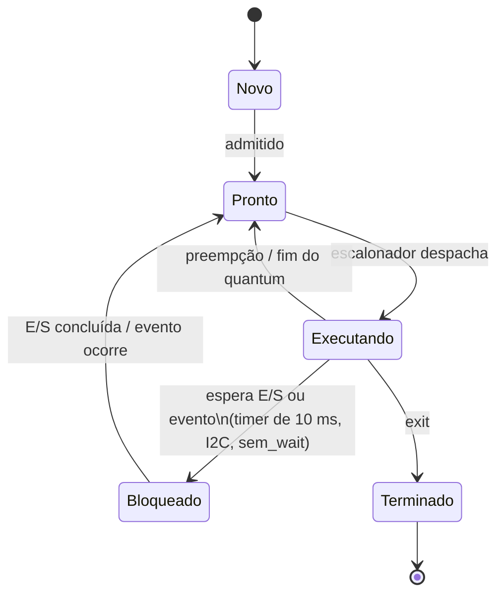
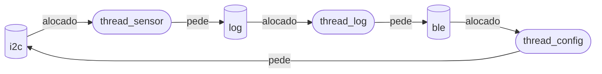

**Anne Esther Lins Figueirôa** | D1 = 4 | D2 = 3 | N = 6

# Ponderada CC08 — Tato: do pipeline ao deadlock

## Parâmetros individuais

Contagem de letras (acentos contam, espaços não):

| Nome | Letras |
|---|---|
| Anne | 4 |
| Esther | 6 |
| Lins | 4 |
| Figueirôa | 9 |
| **Total** | **23** |

- **D1** = letras do primeiro nome = **4**
- **D2** = último dígito de 23 = **3**

| Parâmetro | Fórmula | Conta | Valor |
|---|---|---|---|
| Instruções por amostra (IC) | 100.000 + 20.000 × D2 | 100.000 + 20.000 × 3 | **160.000** |
| Taxa de falta na L1 (m) | 3% + 0,5% × D1 | 3% + 0,5% × 4 | **5% (0,05)** |
| Tamanho do buffer (N) | 3 + (D2 mod 5) | 3 + (3 mod 5) = 3 + 3 | **6** |

Requisito: **≤ 5 ms por amostra**, com período de amostragem de 10 ms.

---

# Parte A — O problema técnico

## A1. Arquitetura e memória: qual processador vai na pulseira?

### A1.1 — Plataforma H (Harvard, 48 MHz, CPI 1,5, sem SO)

```
Ciclos = IC × CPI = 160.000 × 1,5 = 240.000 ciclos
Tempo  = Ciclos / f = 240.000 / (48 × 10⁶ Hz) = 0,005 s = 5,000 ms
```

**Atende, mas no limite exato: 5,000 ms ≤ 5 ms, com margem zero.**

Formalmente o requisito é "no máximo 5 ms", então a conta passa. Como engenharia, eu não aceitaria: qualquer coisa que some um único ciclo (uma interrupção do BLE, um IC um pouco maior numa versão futura do filtro, variação de clock por temperatura) estoura o prazo. A pulseira também ficaria com 50% de ocupação da CPU (5 ms de 10 ms) só no filtro. Margem zero num requisito de segurança não é margem.

### A1.2 — Plataforma V (Von Neumann, 1,2 GHz, cache L1, Linux)

**AMAT** (tempo médio de acesso à memória):

```
AMAT = tempo de acerto + m × penalidade de falta
     = 1 + 0,05 × 120
     = 1 + 6 = 7 ciclos
```

**CPI efetivo** (fórmula do enunciado):

```
CPI_ef = 1,0 + (acessos/instrução × m × penalidade)
       = 1,0 + (1,3 × 0,05 × 120)
       = 1,0 + 7,8 = 8,8
```

Ou seja, 89% do CPI (7,8 de 8,8) são paradas esperando a memória.

**Tempo médio por amostra:**

```
Ciclos = 160.000 × 8,8 = 1.408.000 ciclos
Tempo  = 1.408.000 / (1,2 × 10⁹ Hz) = 1,173 ms
```

**Pior caso** (somando o atraso do SO):

```
T_pior = 1,173 + 3,000 = 4,173 ms
```

**Atende: 4,173 ms ≤ 5 ms**, com folga de 0,827 ms (≈ 17%).

Duas ressalvas que importam para a decisão:

1. **O sistema operacional domina o pior caso:** 3 ms dos 4,173 ms (72%) são o Linux, não o processamento. O processador é rápido; quem ameaça o prazo é o não-determinismo.
2. **O 1,173 ms é tempo médio, mas o requisito é sobre toda amostra.** Se a taxa de falta piorar (outro processo poluindo a cache, por exemplo o BLE), o prazo cai. Taxa máxima de falta que a V tolera:

```
Tempo disponível para processar = 5 − 3 = 2 ms
CPI_max = 2 × 10⁻³ × 1,2 × 10⁹ / 160.000 = 15
1 + 1,3 × m_max × 120 ≤ 15  →  m_max = 14 / 156 ≈ 8,97%
```

Com m = 5% estamos bem, mas **acima de ~9% de falta na L1, a V deixa de atender.**

### A1.3 — Plataforma H com acelerador DSP (Lei de Amdahl)

Fração acelerável: f = 0,6 (filtro). Ganho na fração: k = 5.

```
Speedup = 1 / [(1 − f) + f / k]
        = 1 / [0,4 + 0,6 / 5]
        = 1 / [0,4 + 0,12]
        = 1 / 0,52 ≈ 1,923×

Novo tempo = 5,000 ms / 1,923 = 5,000 × 0,52 = 2,600 ms
```

Conferindo por partes: fora do filtro 0,4 × 5 = 2,0 ms; filtro 0,6 × 5 / 5 = 0,6 ms; total 2,6 ms. ✓

**Atende com folga: 2,6 ms, margem de 2,4 ms (48%)** e ocupação de CPU cai de 50% para 26%.

Observação de Amdahl: mesmo com um DSP infinitamente rápido, o speedup máximo seria 1 / 0,4 = **2,5×** (tempo mínimo de 2,0 ms). Daqui para frente, otimizar o filtro rende pouco; o gargalo passa a ser os 40% restantes.

**Resumo da A1:**

| Opção | Tempo por amostra (pior caso) | Margem até 5 ms | Determinístico? |
|---|---|---|---|
| H | 5,000 ms | 0 ms (0%) | Sim |
| V | 4,173 ms | 0,827 ms (17%) | Não (cache + SO) |
| H + DSP | 2,600 ms | 2,400 ms (48%) | Sim |

### A1.4 — Por que a V precisa de cache e a H não? (gargalo de Von Neumann)

Na V, instruções e dados passam pelo **mesmo barramento** até uma DRAM de 120 ciclos: o gargalo de Von Neumann. Sem cache, cada instrução esperaria 1,3 × 120 ciclos: CPI ≈ 1 + 156 = 157, ou seja **160.000 × 157 / 1,2 GHz ≈ 20,9 ms por amostra**, 4× acima do prazo, apesar do clock 25× maior. A cache esconde essa latência. Na H, instruções e dados têm **barramentos separados** para uma SRAM interna de 1 ciclo, e o clock de 48 MHz é baixo o suficiente para a memória acompanhar a CPU: não existe distância a esconder.

### A1.5 — Evidência da minha máquina


> ⚠️ **ANNE:** tirar o print no seu computador e salvar como `img/caches.png`.
> macOS: `sysctl -a | grep cachesize` · Linux: `lscpu` · Windows: aba *Caches* do CPU-Z.
> Depois, preencher os valores abaixo com os do print.

Meu processador tem **L1 de instruções (L1i: ___ KB) separada da L1 de dados (L1d: ___ KB)**, e as camadas seguintes (L2 de ___ e L3 de ___, quando existe) são unificadas.

Então ele é **Harvard modificado**: no nível do núcleo é Harvard, porque busca instrução e lê dado no mesmo ciclo por caminhos separados (evita o conflito estrutural que existiria no estágio IF × MEM do pipeline da A2). Mas a partir da L2 e na RAM, instruções e dados moram na mesma memória e no mesmo espaço de endereçamento: para o programador e para o sistema operacional, o modelo é **Von Neumann** (é isso que permite carregar um programa do disco como dado e depois executá-lo). Ou seja, a L1 dividida é uma solução Harvard aplicada exatamente onde o gargalo de Von Neumann dói mais.

---

## A2. Pipeline: o loop do filtro

```asm
1  lw   x5, 0(x10)    # lê a amostra nova
2  add  x6, x6, x5    # soma += nova
3  lw   x7, 0(x11)    # lê a amostra mais antiga
4  sub  x6, x6, x7    # soma -= antiga
5  sw   x6, 0(x12)    # grava a soma
6  addi x10, x10, 4   # avança o ponteiro da nova
7  addi x11, x11, 4   # avança o ponteiro da antiga
```

Pipeline de 5 estágios (IF, ID, EX, MEM, WB). Banco de registradores escrito na 1ª metade do ciclo e lido na 2ª: uma instrução pode ler no ID o valor que outra escreve no WB **no mesmo ciclo**.

### A2.1 — Dependências de dados (RAW)

| Produtora | Consumidora | Registrador | Tipo |
|---|---|---|---|
| 1 `lw` | 2 `add` | x5 | load → uso (adjacente) |
| 2 `add` | 4 `sub` | x6 | ALU → ALU (distância 2) |
| 3 `lw` | 4 `sub` | x7 | load → uso (adjacente) |
| 4 `sub` | 5 `sw` | x6 | ALU → store (adjacente) |

Não são RAW, mas restringem a reordenação (A2.4): **WAR** em x10 (1 lê, 6 escreve) e em x11 (3 lê, 7 escreve), e **WAW** em x6 (2 e 4 escrevem). Num pipeline em ordem eles não geram bolha, mas não posso colocar o `addi x10` antes do `lw x5`, por exemplo.

### A2.2 — Sem forwarding

Regra: a consumidora só pode fazer ID no ciclo do WB da produtora (ou depois).
Legenda: **s** = stall (instrução retida no estágio; uma bolha segue no pipeline).

| Instrução | 1 | 2 | 3 | 4 | 5 | 6 | 7 | 8 | 9 | 10 | 11 | 12 | 13 | 14 | 15 | 16 | 17 |
|---|---|---|---|---|---|---|---|---|---|---|---|---|---|---|---|---|---|
| 1 `lw x5` | IF | ID | EX | MEM | WB | | | | | | | | | | | | |
| 2 `add x6` | | IF | s | s | ID | EX | MEM | WB | | | | | | | | | |
| 3 `lw x7` | | | IF | s | s | ID | EX | MEM | WB | | | | | | | | |
| 4 `sub x6` | | | | | | IF | s | s | ID | EX | MEM | WB | | | | | |
| 5 `sw x6` | | | | | | | IF | s | s | s | s | ID | EX | MEM | WB | | |
| 6 `addi x10` | | | | | | | | | | IF | s | s | ID | EX | MEM | WB | |
| 7 `addi x11` | | | | | | | | | | | | | IF | ID | EX | MEM | WB |

- 2 espera o WB de 1 (ciclo 5): **2 bolhas**
- 4 espera o WB de 3 (ciclo 9; o x6 de 2 já foi escrito no ciclo 8): **2 bolhas**
- 5 espera o WB de 4 (ciclo 12): **2 bolhas**

**Total: 17 ciclos** do primeiro IF ao último WB (11 do ideal + 6 bolhas).
Ideal sem conflitos: 5 + (7 − 1) = 11 ciclos. CPI do trecho: 17 / 7 ≈ 2,43.

### A2.3 — Com forwarding (EX/MEM→EX e MEM/WB→EX)

| Instrução | 1 | 2 | 3 | 4 | 5 | 6 | 7 | 8 | 9 | 10 | 11 | 12 | 13 |
|---|---|---|---|---|---|---|---|---|---|---|---|---|---|
| 1 `lw x5` | IF | ID | EX | MEM | WB | | | | | | | | |
| 2 `add x6` | | IF | ID | s | EX | MEM | WB | | | | | | |
| 3 `lw x7` | | | IF | s | ID | EX | MEM | WB | | | | | |
| 4 `sub x6` | | | | | IF | ID | s | EX | MEM | WB | | | |
| 5 `sw x6` | | | | | | IF | s | ID | EX | MEM | WB | | |
| 6 `addi x10` | | | | | | | | IF | ID | EX | MEM | WB | |
| 7 `addi x11` | | | | | | | | | IF | ID | EX | MEM | WB |

Caminhos de forwarding usados:
- ciclo 5: x5 de 1 (saída da MEM, registrador MEM/WB) → EX de 2
- ciclo 8: x7 de 3 (MEM/WB) → EX de 4; x6 de 2 já está no banco (escrito no ciclo 7)
- ciclo 9: x6 de 4 (resultado da ALU, registrador EX/MEM) → EX de 5

**Total: 13 ciclos** (11 + 2 bolhas). CPI do trecho: 13 / 7 ≈ 1,86.

**Quais dependências ainda causam bolha: as duas load → uso (1→2 por x5 e 3→4 por x7).** O motivo é temporal, não de fiação: o `lw` só tem o dado da memória **no fim do estágio MEM**, e a instrução seguinte precisa dele **no começo do EX**, que acontece no mesmo ciclo. Forwarding só leva um valor para frente no tempo; não consegue entregar um dado que ainda não existe. Então o hardware precisa segurar a instrução dependente por 1 ciclo (*load-use hazard*). As dependências ALU → ALU e ALU → store somem com forwarding porque o resultado sai no fim do EX, a tempo do próximo EX.

### A2.4 — Reordenação sem bolhas

Basta trocar as instruções 2 e 3: o segundo `lw` preenche o atraso do primeiro.

```asm
1  lw   x5, 0(x10)    # lê a amostra nova
3  lw   x7, 0(x11)    # lê a amostra mais antiga   ← subiu
2  add  x6, x6, x5    # soma += nova               (x5 a 2 instruções do lw: OK)
4  sub  x6, x6, x7    # soma -= antiga             (x7 a 2 instruções do lw: OK)
5  sw   x6, 0(x12)    # grava a soma               (x6 por EX/MEM→EX)
6  addi x10, x10, 4
7  addi x11, x11, 4
```

| Instrução | 1 | 2 | 3 | 4 | 5 | 6 | 7 | 8 | 9 | 10 | 11 |
|---|---|---|---|---|---|---|---|---|---|---|---|
| `lw x5` | IF | ID | EX | MEM | WB | | | | | | |
| `lw x7` | | IF | ID | EX | MEM | WB | | | | | |
| `add x6` | | | IF | ID | EX | MEM | WB | | | | |
| `sub x6` | | | | IF | ID | EX | MEM | WB | | | |
| `sw x6` | | | | | IF | ID | EX | MEM | WB | | |
| `addi x10` | | | | | | IF | ID | EX | MEM | WB | |
| `addi x11` | | | | | | | IF | ID | EX | MEM | WB |

Forwarding: x5 MEM/WB→EX no ciclo 5; x7 MEM/WB→EX e x6 EX/MEM→EX no ciclo 6; x6 EX/MEM→EX no ciclo 7.

**Novo total: 11 ciclos, zero bolhas** (CPI = 11/7 ≈ 1,57, o mínimo para 7 instruções num pipeline de 5 estágios; ganho de 15% sobre os 13 ciclos).

**Por que o resultado não muda:** as duas cargas leem endereços diferentes (x10 e x11) e nada entre elas escreve memória; `soma + nova − antiga` continua sendo calculado na mesma ordem; o `sw` continua depois do `sub`; e os `addi` continuam depois dos `lw` que leem x10/x11 (respeitando os WAR).

---

## A3. Processos e threads: como organizar o software

### A3.1 — Organização proposta

```
┌──────── Processo 1: "tato-rt" (tempo real, SCHED_FIFO, prioridade alta) ────────┐
│  thread_sensor ──► buffer circular ──► thread_processa ──► thread_motor           │
│                        (memória compartilhada, semáforos da A4)                    │
└───────────────────────────────┬──────────────────────────────────────────────────┘
                                │  IPC: fila de mensagens POSIX (não bloqueante)
                                │  log ─►            ◄─ comandos de configuração
┌───────────────────────────────┴──────────────────────────────────────────────────┐
│  Processo 2: "tato-ble" (prioridade normal, usuário sem privilégios, sandbox)     │
└──────────────────────────────────────────────────────────────────────────────────┘
```

**Sensor, processamento e motor: threads do mesmo processo.**
- **Compartilhamento de memória:** as três formam a cadeia crítica de 5 ms e trocam uma amostra a cada 10 ms. Como threads, passam um ponteiro para o mesmo buffer, sem cópia e sem chamada de sistema de IPC.
- **Custo de troca de contexto:** trocar entre threads do mesmo processo não troca o espaço de endereçamento (não recarrega a tabela de páginas, não invalida a TLB, a cache continua "quente"). Na V, onde 89% do CPI já é espera de memória (A1.2), sujar a cache a cada troca seria caro.
- **Custo de criação:** são criadas uma vez no boot, mas threads ainda são mais baratas (não duplicam espaço de endereçamento).
- **Isolamento:** aqui eu aceito *não* ter isolamento, porque as três são código nosso, pequeno, auditável, e sem entrada externa. Se uma falhar, a pulseira já perdeu a função de qualquer forma.

**BLE: processo separado.**
- **Isolamento de falhas:** é a única tarefa que recebe dados de fora e tem a pilha mais complexa. Se travar ou der *segfault*, só ele morre; o processo de tempo real continua vibrando, e o supervisor (systemd) o reinicia.
- **Não está no caminho crítico:** o log pode chegar com 100 ms de atraso que ninguém se machuca. O custo extra do processo (cópia pela IPC, troca de contexto com troca de espaço de endereçamento, da ordem de microssegundos) cai inteiro numa tarefa sem prazo apertado.
- **Comunicação desacoplada:** o lado de tempo real só faz *envio não bloqueante* do log; se a fila do BLE estiver cheia, o log é descartado e a vibração não espera. Comandos de configuração chegam pela fila e são validados antes de aplicar.

### A3.2 — BLE explorado: thread × processo

| | BLE como **thread** | BLE como **processo separado** |
|---|---|---|
| O que o atacante alcança | Todo o espaço de endereçamento: buffer de amostras, estado do motor, código, dados | Só a memória do próprio processo BLE (a MMU impede o resto) |
| Pior cenário para o usuário | **Desligar a vibração em silêncio** ou injetar amostras falsas: a pessoa anda achando que o caminho está livre | Mandar comandos de configuração pela fila de IPC, que são validados |
| Se o exploit derrubar o código | O processo inteiro morre: sensor e motor juntos | Só o BLE cai; a vibração continua |
| Privilégios | Os mesmos do processo de tempo real (acesso a I2C, motor, prioridade RT) | Usuário sem privilégios, sem acesso a `/dev/i2c` nem ao GPIO do motor, com seccomp |

Como processo separado, a **superfície de ataque** deixa de ser "toda a memória do sistema" e passa a ser "o formato das mensagens da fila". Não é segurança absoluta (uma falha no kernel ou um comando *válido* malicioso ainda são riscos), por isso a validação no processo de tempo real deve garantir invariantes de segurança: nenhum comando pode desligar a vibração ou levar a sensibilidade abaixo de um mínimo seguro.

### A3.3 — Diagrama de estados de um processo



**A thread do sensor passa a maior parte do tempo em Bloqueado.** Ela trabalha uma vez a cada 10 ms: acorda pelo timer, dispara a leitura no I2C (e bloqueia de novo até a transferência terminar), entrega a amostra no buffer e volta a dormir até o próximo período (`clock_nanosleep`). Se a leitura levar ~100 µs, ela fica bloqueada ~99% do tempo. É uma tarefa *I/O-bound* clássica: o ritmo é ditado pelo mundo físico, não pela CPU.

Isso só vale porque ela **bloqueia** em vez de fazer espera ocupada. Na versão 1 da A4 (busy waiting), as threads ficariam alternando entre Executando e Pronto, gastando CPU e bateria e competindo com a thread de processamento, justamente a que tem o prazo de 5 ms.

---

## A4. Código com semáforos: buffer entre o sensor e o motor

Código em [`/ponderada/codigo`](codigo/) (Python 3, `threading`). Cada script roda as 3 execuções de 20.000 amostras e imprime a tabela. N = 6.

### Resultados

| Versão | Exec | Consumidas | Perdidas | Duplicadas | Travou? |
|---|---|---|---|---|---|
| 1 — sem sincronização | 1 | 20.074 | 2.495 | 2.569 | Não |
| 1 — sem sincronização | 2 | 20.064 | 2.539 | 2.603 | Não |
| 1 — sem sincronização | 3 | 20.612 | 2.521 | 3.133 | Não |
| 2 — semáforos | 1 | 20.000 | 0 | 0 | Não |
| 2 — semáforos | 2 | 20.000 | 0 | 0 | Não |
| 2 — semáforos | 3 | 20.000 | 0 | 0 | Não |
| 3 — ordem trocada | 1 | 0 | 20.000* | 0 | **Sim** |
| 3 — ordem trocada | 2 | 0 | 20.000* | 0 | **Sim** |
| 3 — ordem trocada | 3 | 0 | 20.000* | 0 | **Sim** |

\* Na versão 3, 6 amostras (0 a 5) ficaram presas no buffer e as outras 19.994 nunca chegaram a ser produzidas: nenhuma chegou ao motor.

**Checagem de consistência da versão 1:** consumidas = 20.000 − perdidas + duplicadas, em todas as execuções (20.000 − 2.495 + 2.569 = 20.074 ✓; 20.000 − 2.539 + 2.603 = 20.064 ✓; 20.000 − 2.521 + 3.133 = 20.612 ✓). Os erros não são ruído de medição, são exatamente o efeito do contador corrompido.

### Prints

**Versão 1:**


**Versão 2:**


**Versão 3:**


### Região crítica da versão 1 e por que ela perde ou duplica

A região crítica é o **read-modify-write do contador compartilhado** (junto com o acesso à posição do buffer que ele autoriza):

```python
lido = estado["contador"]      # lê
time.sleep(0)                  # ← a thread pode perder a CPU aqui
estado["contador"] = lido + 1  # escreve (produtor) / lido - 1 (consumidor)
```

`contador += 1` parece uma operação, mas são três (ler, somar, escrever). Se a outra thread escreve no meio, uma das escritas se perde (*lost update*). O GIL do Python não protege isso: ele garante bytecodes atômicos, não sequências de bytecodes; o `sleep(0)` força a troca exatamente no pior ponto.

- **Duplicação:** produtor lê contador = 3 e é interrompido; consumidor retira uma amostra e grava 2; produtor volta e grava 3 + 1 = **4**. Há só 3 amostras reais, mas o contador diz 4. O consumidor vai ler uma posição já consumida: **amostra duplicada**.
- **Perda:** o inverso. Consumidor lê 3 e é interrompido; produtor insere e grava 4; consumidor volta e grava 3 − 1 = **2**. Há 3 amostras reais, mas o contador diz 2. O produtor acha que tem uma vaga a mais e **sobrescreve uma amostra que ainda não foi consumida: perdida**.

Os dois erros aparecem em quantidade parecida (≈ 2.500 de cada, ~12,5% das amostras), o que bate com a simetria da corrida.

**Por que não travou:** com um produtor e um consumidor, o contador corrompido quase sempre é > 0 ou < N, então sempre alguém consegue andar. O modo de falha não foi o travamento, foi **corrupção silenciosa**, e isso é pior para a pessoa usando a pulseira: ela não percebe nada de errado. Uma amostra duplicada é uma vibração baseada numa leitura velha (o poste já está mais perto do que a pulseira diz); uma amostra perdida é um obstáculo que nunca vira vibração.

### O que cada semáforo garante na versão 2

| Semáforo | Valor inicial | Quem faz `wait` | Garantia |
|---|---|---|---|
| `vazio` | N = 6 | Produtor, antes de inserir | Conta vagas livres. O produtor **bloqueia com o buffer cheio**, então nunca sobrescreve uma amostra não consumida: **zero perdas** |
| `cheio` | 0 | Consumidor, antes de retirar | Conta amostras disponíveis. O consumidor **bloqueia com o buffer vazio**, então nunca lê uma posição velha: **zero duplicações** |
| `mutex` | 1 | Os dois, em volta do acesso ao buffer | **Exclusão mútua**: só uma thread por vez mexe no buffer, nos índices e no contador. Com 1 produtor e 1 consumidor ele protege o contador compartilhado; com vários produtores ou consumidores, também impede dois de usarem a mesma posição |

Evidências: 20.000 consumidas, 0 perdidas, 0 duplicadas, contador final 0 e **todas as amostras em ordem**, nas 3 execuções, mesmo com o mesmo `sleep(0)` dentro da região crítica. A interrupção continua acontecendo, mas não causa dano, porque ninguém mais consegue entrar. E não há espera ocupada: a thread sem trabalho vai para o estado Bloqueado (A3.3).

O custo: a versão 2 levou ~3,0 s contra ~1,6 s da versão 1. É o preço da sincronização, e é o preço certo: a versão 1 é mais rápida porque está errada.

### O que aconteceu na versão 3, e por quê

**Deadlock nas 3 execuções, com 0 amostras entregues ao motor.** O diagnóstico do próprio programa mostra onde cada thread parou:

- **produtor:** segurando o `mutex`, esperando `vazio` (na amostra 6)
- **consumidor:** esperando o `mutex` (com o buffer cheio)

A sequência: o produtor faz `wait(mutex)` → `wait(vazio)` → insere → libera, e repete. Como ele readquire o mutex logo depois de soltar, encheu as 6 posições (amostras 0 a 5, `vazio` chegou a 0) antes do consumidor conseguir entrar. Na amostra 6 ele pegou o `mutex` e **dormiu em `vazio` sem soltar o `mutex`**. O consumidor tem 6 amostras para retirar (`cheio` = 6), mas precisa do `mutex` para isso, e quem o tem está dormindo esperando uma vaga que só o consumidor pode criar.

**Espera circular entre duas threads:** produtor → espera `vazio` → que só o consumidor libera → consumidor espera `mutex` → que o produtor segura. As quatro condições de Coffman aparecem (detalhadas na A5).

A lição: **a ordem dos `signal` não importa, mas a ordem dos `wait` importa.** Nunca se deve dormir esperando um recurso de contagem (`vazio`/`cheio`) segurando o `mutex`. Sem o timeout de 1 s que usei para detectar o travamento, o programa ficaria parado para sempre, exatamente o sintoma da A5: "a pulseira congelou e só voltou depois de desligar e ligar".

Um detalhe que eu acho importante: aqui o deadlock aparece **sempre e na hora**, porque o buffer enche em microssegundos. Isso é bom, um teste pega. O deadlock da A5 é o tipo perigoso: depende de uma intercalação rara e passa nos testes.

---

## A5. Deadlock: a pulseira congelou

```
thread_sensor:        thread_log:        thread_config:
P(i2c)                P(log)             P(ble)
le_sensor()           le_log()           recebe_comando()
P(log)                P(ble)             P(i2c)
registra()            envia()            ajusta_sensor()
V(log)                V(ble)             V(i2c)
V(i2c)                V(log)             V(ble)
```

### A5.1 — Sequência que leva ao deadlock e grafo de alocação

| Passo | Thread | Operação | Resultado |
|---|---|---|---|
| 1 | sensor | `P(i2c)` | obtém i2c; executa `le_sensor()`; é preemptada |
| 2 | log | `P(log)` | obtém log; executa `le_log()`; é preemptada |
| 3 | config | `P(ble)` | obtém ble; executa `recebe_comando()` |
| 4 | config | `P(i2c)` | **bloqueia** (i2c é do sensor) |
| 5 | sensor | `P(log)` | **bloqueia** (log é da thread_log) |
| 6 | log | `P(ble)` | **bloqueia** (ble é da config) |

Depois do passo 6, as três estão bloqueadas e nenhuma vai executar um `V`: **deadlock**. Nesse instante, o grafo de alocação de recursos (seta recurso → thread = alocado; thread → recurso = pedido):



Ciclo: sensor → log → thread_log → ble → config → i2c → sensor. Como cada recurso tem **uma única instância**, ciclo no grafo implica deadlock com certeza.

### A5.2 — As quatro condições de Coffman no código

| Condição | Onde aparece |
|---|---|
| **Exclusão mútua** | Os três recursos são protegidos por semáforos binários (iniciados em 1): só uma thread usa o barramento I2C, o arquivo de log ou o rádio BLE por vez. Faz sentido físico, dois acessos simultâneos ao I2C corromperiam a transação |
| **Posse e espera** | Cada thread chama o segundo `P` **sem soltar o primeiro**: o sensor segura i2c enquanto pede log; o log segura log enquanto pede ble; a config segura ble enquanto pede i2c |
| **Não preempção** | Um semáforo não pode ser tomado de quem o segurou; só a própria thread faz o `V`. Nenhum mecanismo força a liberação |
| **Espera circular** | Cada thread pega os recursos numa ordem diferente: (i2c, log), (log, ble), (ble, i2c). Juntas formam o ciclo i2c → log → ble → i2c |

As quatro precisam estar presentes ao mesmo tempo; basta quebrar uma para o deadlock ficar impossível.

### A5.3 — Duas correções de tipos diferentes

**Correção 1 — Prevenção: eliminar posse e espera (e, de quebra, a espera circular)**

Olhando o código, **nenhuma das três threads precisa de dois recursos ao mesmo tempo**: o sensor só precisa do log *depois* de ler; o log só precisa do BLE *depois* de ler o arquivo; a config só precisa do I2C *depois* de receber o comando. Então cada thread libera um recurso antes de pedir o próximo, guardando o dado numa variável local:

```
thread_sensor:          thread_log:            thread_config:
P(i2c)                  P(log)                 P(ble)
amostra = le_sensor()   dados = le_log()       cmd = recebe_comando()
V(i2c)                  V(log)                 V(ble)
P(log)                  P(ble)                 P(i2c)
registra(amostra)       envia(dados)           ajusta_sensor(cmd)
V(log)                  V(ble)                 V(i2c)
```

Nenhuma thread segura um recurso enquanto espera outro, então nunca há posse e espera, e o grafo nunca forma ciclo. Alternativa equivalente se algum par precisar mesmo ser atômico: **ordem global** (i2c < log < ble) e todo mundo pede em ordem crescente, o que quebra a espera circular.

*O que muda para quem usa a pulseira:* nada visível, e um ganho: o deadlock deixa de ser possível por construção, e o barramento I2C fica preso por menos tempo (o sensor não segura o I2C enquanto escreve no log), então a próxima leitura fica livre mais cedo, o que reduz a latência no caminho crítico.

**Correção 2 — Detecção e recuperação: watchdog**

Cada thread crítica (sensor e motor) atualiza um *heartbeat* a cada ciclo. Um **watchdog de hardware** do SoC precisa ser "alimentado" a cada, por exemplo, 200 ms; se o heartbeat parar (o sistema travou, seja por este deadlock ou por qualquer outro bug), o watchdog não é alimentado e reinicia a pulseira sozinho. Antes de reiniciar (ou logo ao voltar), o motor dá **um pulso longo** para avisar a pessoa. Ele precisa ser de hardware: um watchdog implementado como mais uma thread poderia ficar preso no mesmo deadlock.

*O que muda para quem usa a pulseira:* o "congelou até eu desligar e ligar" vira **alguns segundos sem vibração (≈ 4 s, pelo dado da Parte B), avisados por um pulso longo**, e a pulseira volta sozinha. É uma melhora enorme, mas o deadlock continua acontecendo: a pessoa ainda fica uns segundos "cega", e se isso acontecer bem na frente de um obstáculo, o risco é real. Por isso o watchdog é rede de segurança (e deve existir mesmo depois da correção 1, contra bugs que ainda não conhecemos), não a solução definitiva.

---

# Parte B — A decisão do CTO

## Memorando ao Conselho da Tato — Dilema 2: qual processador vai para a produção

**Decisão: a Tato vai produzir com a Plataforma H com o acelerador DSP, a R$ 37 por unidade.**

**Por quê.** Nossos números da Parte A: a H sozinha processa uma amostra em **5,000 ms**, exatamente no limite de 5 ms: margem zero, descartada. A V atende, com **4,17 ms** no pior caso, mas 3 ms disso são o Linux, e o tempo depende de a taxa de falta de cache ficar abaixo de **~9%** (hoje 5%): é um prazo que *provavelmente* cumprimos. A H com DSP leva **2,6 ms**, sem sistema operacional e sem cache, ou seja, o mesmo tempo em toda amostra, com 48% de margem. Num produto em que um atraso significa a pessoa trombar num poste, eu prefiro a garantia determinística à média rápida. O que mais pesou foi isto: na V, o pior caso não é calculado, é um "até 3 ms" que o Linux sem tempo real não garante formalmente.

**Do que estamos abrindo mão.** Abrimos mão da **atualização pela internet (OTA)**. Toda correção de firmware, inclusive de segurança, exigirá cabo na assistência técnica. Quem paga esse custo é, primeiro, **o usuário**: uma pessoa com deficiência visual terá que se deslocar até a assistência para receber uma correção, o que é um custo real de acessibilidade. E paga a **empresa**, em logística: se o deadlock da A5 tivesse ido para o campo, teríamos que fazer um recall em vez de mandar um patch. Para reduzir isso, vamos oferecer troca por correio (mandamos uma pulseira atualizada, recebemos a antiga) e testar o firmware muito mais antes de lançar. Em troca, economizamos **R$ 33 por unidade (R$ 66 mil no primeiro lote de 2.000)** e ganhamos bateria, porque um microcontrolador de 48 MHz com SRAM consome muito menos que um SoC de 1,2 GHz com DRAM.

**Impacto no usuário e risco de segurança.** Para quem usa, a H com DSP é a opção mais previsível: a vibração chega sempre no mesmo tempo, e a bateria dura mais. Do lado da segurança, a superfície de ataque é muito menor (sem Linux, sem pilha de rede, só o BLE), mas o risco que escolhemos aceitar é este: **se aparecer uma vulnerabilidade no BLE, ela ficará nas pulseiras em campo por semanas, até cada pessoa trocar o firmware**. Por isso o módulo BLE será mínimo: ele só envia log e aceita um conjunto fechado de comandos validados, e nenhum comando pode desligar a vibração.

**O que me faria mudar de ideia.** Se um teste de estresse de 72 horas na Plataforma V com Linux PREEMPT_RT (kernel de tempo real) mostrar **latência máxima do sistema abaixo de 1 ms**, o pior caso da V cai para ~2,2 ms, igual ou melhor que os 2,6 ms da H com DSP. Nesse cenário, a diferença de R$ 33 por unidade compraria o OTA sem sacrificar o prazo, e eu recomendaria migrar para a V no segundo lote.

— Anne Esther Lins Figueirôa, CTO
