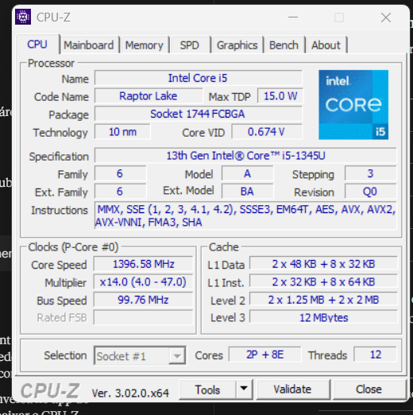
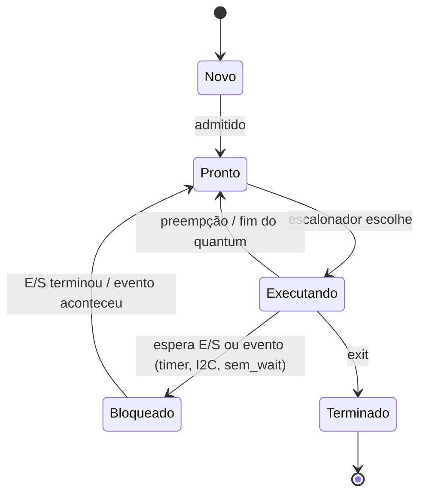
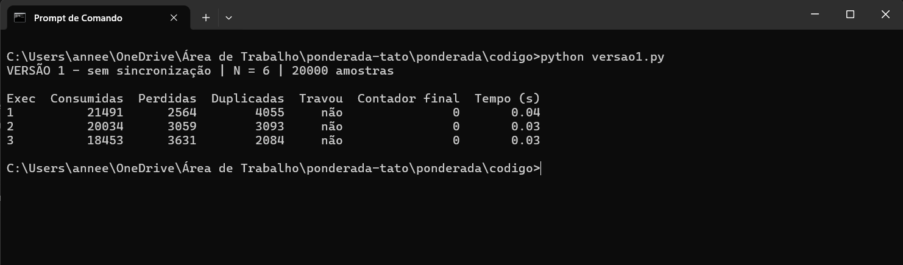
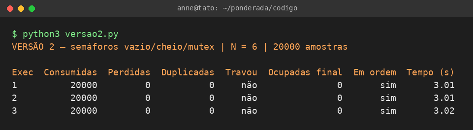
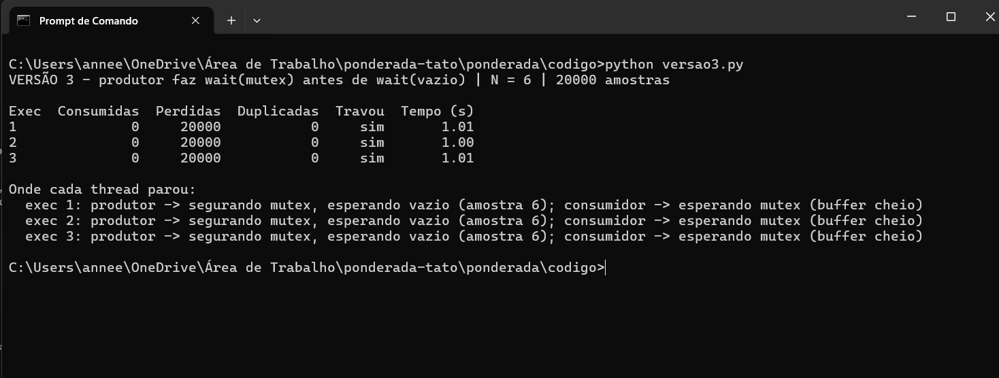

Anne Esther Lins Figueirôa | D1 = 4 | D2 = 3 | N = 6

# Ponderada CC08: do pipeline ao deadlock (Tato)

## Parâmetros

Contei só as letras do nome completo, sem os espaços:

| Nome | Letras |
|---|---|
| Anne | 4 |
| Esther | 6 |
| Lins | 4 |
| Figueirôa | 9 |
| Total | 23 |

D1 é o número de letras do primeiro nome, então D1 = 4. D2 é o último dígito do total (23), então D2 = 3.

| Parâmetro | Fórmula | Conta | Valor |
|---|---|---|---|
| Instruções por amostra (IC) | 100.000 + 20.000 × D2 | 100.000 + 20.000 × 3 | 160.000 |
| Taxa de falta na L1 (m) | 3% + 0,5% × D1 | 3% + 0,5% × 4 | 5% |
| Tamanho do buffer (N) | 3 + (D2 mod 5) | 3 + 3 | 6 |

O requisito é processar cada amostra em no máximo 5 ms, e chega uma amostra nova a cada 10 ms.

---

# Parte A: o problema técnico

## A1. Qual processador vai na pulseira

### A1.1 Plataforma H

```
Ciclos = IC × CPI = 160.000 × 1,5 = 240.000 ciclos
Tempo  = 240.000 / 48.000.000 Hz = 0,005 s = 5,000 ms
```

Dá exatamente 5 ms. Pelo enunciado ("no máximo 5 ms") ela atende, mas com margem zero. Na prática eu não confiaria nisso, porque qualquer coisa a mais (uma interrupção do BLE, uma mudança pequena no filtro numa versão futura) já faz passar do prazo. Além disso, o processador ficaria 50% do tempo ocupado só com o filtro (5 ms de cada 10 ms).

### A1.2 Plataforma V

Tempo médio de acesso à memória:

```
AMAT = acerto + m × penalidade
     = 1 + 0,05 × 120
     = 7 ciclos
```

CPI efetivo, usando a fórmula do enunciado:

```
CPI_ef = 1,0 + (1,3 × 0,05 × 120)
       = 1,0 + 7,8
       = 8,8
```

Ou seja, de 8,8 ciclos por instrução, 7,8 são o processador parado esperando a memória.

Tempo médio por amostra:

```
Ciclos = 160.000 × 8,8 = 1.408.000 ciclos
Tempo  = 1.408.000 / 1.200.000.000 Hz = 1,173 ms
```

Pior caso, somando o atraso do Linux:

```
1,173 + 3 = 4,173 ms
```

A V atende, com uma folga de 0,827 ms (uns 17%).

Duas observações que eu acho importantes aqui. Primeiro, dos 4,173 ms do pior caso, 3 ms são do sistema operacional. O processador em si é rápido; o que coloca o prazo em risco é o Linux. Segundo, o 1,173 ms é um tempo médio, e o requisito vale para toda amostra. Se a taxa de falta subir (por exemplo, o processo do BLE disputando a cache), o tempo sobe junto. Calculei até onde ela aguenta:

```
Sobram 5 - 3 = 2 ms para processar
CPI máximo = 0,002 × 1.200.000.000 / 160.000 = 15
1 + 1,3 × m × 120 ≤ 15  →  m ≤ 14 / 156 ≈ 8,97%
```

Então, com a taxa de falta acima de uns 9%, a V deixa de cumprir o prazo. Com os meus 5% está tudo bem, mas a margem não é tão grande quanto parece.

### A1.3 Plataforma H com DSP (Lei de Amdahl)

O filtro é 60% do tempo (f = 0,6) e o DSP deixa ele 5 vezes mais rápido (k = 5):

```
Speedup = 1 / [(1 - f) + f / k]
        = 1 / [0,4 + 0,6 / 5]
        = 1 / 0,52
        ≈ 1,923

Novo tempo = 5,000 / 1,923 = 2,6 ms
```

Conferindo por partes: a parte que não é filtro continua levando 0,4 × 5 = 2,0 ms, e o filtro passa a levar 0,6 × 5 / 5 = 0,6 ms. Total de 2,6 ms, então bate.

Agora atende com folga: sobram 2,4 ms (48%), e a ocupação do processador cai de 50% para 26%.

Um detalhe da Lei de Amdahl: mesmo que o DSP fosse infinitamente rápido, o speedup máximo seria 1 / 0,4 = 2,5, ou seja, nunca daria menos que 2 ms. A partir daqui, melhorar o filtro rende pouco, porque o que pesa são os outros 40%.

Resumo da A1:

| Opção | Pior caso | Folga até 5 ms | Tempo sempre igual? |
|---|---|---|---|
| H | 5,000 ms | 0 ms (0%) | Sim |
| V | 4,173 ms | 0,827 ms (17%) | Não (depende da cache e do Linux) |
| H + DSP | 2,600 ms | 2,400 ms (48%) | Sim |

### A1.4 Por que a V precisa de cache e a H não

Na V, instruções e dados usam o mesmo caminho até uma DRAM que demora 120 ciclos, que é justamente o gargalo de Von Neumann. Sem cache, cada instrução esperaria 1,3 × 120 ciclos, o CPI iria para uns 157 e cada amostra levaria cerca de 160.000 × 157 / 1,2 GHz ≈ 20,9 ms, quatro vezes acima do prazo mesmo com um clock 25 vezes maior. A H tem caminhos separados para instruções e dados, numa SRAM de 1 ciclo, e o clock de 48 MHz é lento o bastante para a memória acompanhar, então não tem atraso para esconder.

### A1.5 Caches do meu computador



Print do CPU-Z no meu notebook (Windows). O processador é um Intel Core i5-1345U (13ª geração, Raptor Lake), que é híbrido: tem 2 núcleos de desempenho (P-cores) e 8 de eficiência (E-cores), por isso cada linha da cache aparece em duas partes.

| Nível | Valor no CPU-Z | Como é dividido |
|---|---|---|
| L1 de dados (L1 Data) | 2 × 48 KB + 8 × 32 KB | uma por núcleo |
| L1 de instruções (L1 Inst.) | 2 × 32 KB + 8 × 64 KB | uma por núcleo |
| L2 | 2 × 1,25 MB + 2 × 2 MB | uma por P-core e uma para cada grupo de 4 E-cores |
| L3 | 12 MB | uma só, compartilhada por todos os núcleos |

Sim, a minha L1 é dividida: cada núcleo tem uma L1 só para dados e outra só para instruções. A L2 e a L3 não fazem essa separação, guardam dados e instruções juntos.

Então ele é Harvard modificado. Dentro do núcleo ele funciona como Harvard, porque consegue buscar uma instrução e ler um dado no mesmo ciclo por caminhos separados (o que evita o conflito entre os estágios IF e MEM do pipeline da A2). Mas da L2 para baixo, e na RAM, instruções e dados ficam na mesma memória e no mesmo espaço de endereçamento, então para o sistema operacional e para quem programa ele é Von Neumann. É isso que permite, por exemplo, carregar um programa do disco como se fosse dado e depois executar. A L1 separada acaba sendo uma ideia de Harvard usada exatamente no ponto onde o gargalo de Von Neumann mais atrapalharia.

---

## A2. Pipeline do filtro

```asm
1  lw   x5, 0(x10)    # lê a amostra nova
2  add  x6, x6, x5    # soma += nova
3  lw   x7, 0(x11)    # lê a amostra mais antiga
4  sub  x6, x6, x7    # soma -= antiga
5  sw   x6, 0(x12)    # grava a soma
6  addi x10, x10, 4   # avança o ponteiro da nova
7  addi x11, x11, 4   # avança o ponteiro da antiga
```

Considerando que o banco de registradores é escrito na primeira metade do ciclo e lido na segunda, uma instrução consegue ler no ID o valor que outra está escrevendo no WB no mesmo ciclo.

### A2.1 Dependências RAW

| Produz | Usa | Registrador | Observação |
|---|---|---|---|
| 1 (lw) | 2 (add) | x5 | load seguido de uso |
| 2 (add) | 4 (sub) | x6 | distância de 2 instruções |
| 3 (lw) | 4 (sub) | x7 | load seguido de uso |
| 4 (sub) | 5 (sw) | x6 | instruções vizinhas |

Também existem dependências que não são RAW mas que limitam a reordenação na A2.4: WAR em x10 (1 lê, 6 escreve), WAR em x11 (3 lê, 7 escreve) e WAW em x6 (2 e 4 escrevem). Elas não geram bolha num pipeline em ordem, mas eu não posso, por exemplo, colocar o addi x10 antes do lw x5.

### A2.2 Sem forwarding

A instrução que depende só pode fazer o ID no mesmo ciclo do WB da instrução da qual ela depende (ou depois). Na tabela, "s" é um ciclo de stall: a instrução fica parada no estágio e uma bolha segue pelo pipeline.

| Instrução | 1 | 2 | 3 | 4 | 5 | 6 | 7 | 8 | 9 | 10 | 11 | 12 | 13 | 14 | 15 | 16 | 17 |
|---|---|---|---|---|---|---|---|---|---|---|---|---|---|---|---|---|---|
| 1 lw x5 | IF | ID | EX | MEM | WB | | | | | | | | | | | | |
| 2 add x6 | | IF | s | s | ID | EX | MEM | WB | | | | | | | | | |
| 3 lw x7 | | | IF | s | s | ID | EX | MEM | WB | | | | | | | | |
| 4 sub x6 | | | | | | IF | s | s | ID | EX | MEM | WB | | | | | |
| 5 sw x6 | | | | | | | IF | s | s | s | s | ID | EX | MEM | WB | | |
| 6 addi x10 | | | | | | | | | | IF | s | s | ID | EX | MEM | WB | |
| 7 addi x11 | | | | | | | | | | | | | IF | ID | EX | MEM | WB |

- a 2 espera o WB da 1 (ciclo 5): 2 bolhas
- a 4 espera o WB da 3 (ciclo 9); o x6 da 2 já foi escrito no ciclo 8: 2 bolhas
- a 5 espera o WB da 4 (ciclo 12): 2 bolhas

Total de 17 ciclos do primeiro IF ao último WB. Sem nenhum conflito seriam 5 + (7 - 1) = 11 ciclos, então são 6 bolhas. O CPI do trecho fica 17 / 7 ≈ 2,43.

### A2.3 Com forwarding

| Instrução | 1 | 2 | 3 | 4 | 5 | 6 | 7 | 8 | 9 | 10 | 11 | 12 | 13 |
|---|---|---|---|---|---|---|---|---|---|---|---|---|---|
| 1 lw x5 | IF | ID | EX | MEM | WB | | | | | | | | |
| 2 add x6 | | IF | ID | s | EX | MEM | WB | | | | | | |
| 3 lw x7 | | | IF | s | ID | EX | MEM | WB | | | | | |
| 4 sub x6 | | | | | IF | ID | s | EX | MEM | WB | | | |
| 5 sw x6 | | | | | | IF | s | ID | EX | MEM | WB | | |
| 6 addi x10 | | | | | | | | IF | ID | EX | MEM | WB | |
| 7 addi x11 | | | | | | | | | IF | ID | EX | MEM | WB |

Forwardings usados:
- ciclo 5: x5 da 1, que sai da MEM (registrador MEM/WB), vai para o EX da 2
- ciclo 8: x7 da 3 (MEM/WB) vai para o EX da 4; o x6 da 2 já está no banco desde o ciclo 7
- ciclo 9: x6 da 4, que sai da ALU (registrador EX/MEM), vai para o EX da 5

Total de 13 ciclos, com 2 bolhas. CPI de 13 / 7 ≈ 1,86.

As dependências que continuam dando bolha são as duas de load seguido de uso: 1 para 2 (x5) e 3 para 4 (x7). O motivo é de tempo. O lw só tem o dado lido da memória no final do estágio MEM, e a instrução seguinte precisa dele no começo do EX, que acontece nesse mesmo ciclo. O forwarding consegue adiantar um valor que já existe, mas não consegue entregar um valor que ainda não foi lido, então o hardware tem que segurar a instrução seguinte por 1 ciclo. Já as dependências entre instruções de ALU somem, porque o resultado da ALU fica pronto no fim do EX, a tempo do EX seguinte.

### A2.4 Reordenando para tirar as bolhas

Basta trocar a 2 com a 3. Assim o segundo lw ocupa o ciclo em que antes a add ficava esperando:

```asm
1  lw   x5, 0(x10)    # lê a amostra nova
3  lw   x7, 0(x11)    # lê a amostra mais antiga (subiu)
2  add  x6, x6, x5    # x5 agora está a 2 instruções do lw
4  sub  x6, x6, x7    # x7 agora está a 2 instruções do lw
5  sw   x6, 0(x12)    # x6 vem por EX/MEM -> EX
6  addi x10, x10, 4
7  addi x11, x11, 4
```

| Instrução | 1 | 2 | 3 | 4 | 5 | 6 | 7 | 8 | 9 | 10 | 11 |
|---|---|---|---|---|---|---|---|---|---|---|---|
| lw x5 | IF | ID | EX | MEM | WB | | | | | | |
| lw x7 | | IF | ID | EX | MEM | WB | | | | | |
| add x6 | | | IF | ID | EX | MEM | WB | | | | |
| sub x6 | | | | IF | ID | EX | MEM | WB | | | |
| sw x6 | | | | | IF | ID | EX | MEM | WB | | |
| addi x10 | | | | | | IF | ID | EX | MEM | WB | |
| addi x11 | | | | | | | IF | ID | EX | MEM | WB |

Forwardings: x5 por MEM/WB no ciclo 5; x7 por MEM/WB e x6 por EX/MEM no ciclo 6; x6 por EX/MEM no ciclo 7.

Total de 11 ciclos, sem nenhuma bolha, que é o mínimo possível para 7 instruções num pipeline de 5 estágios (CPI ≈ 1,57). Comparado com os 13 ciclos da A2.3, são 15% a menos.

O resultado não muda porque os dois lw leem endereços diferentes e nada entre eles escreve na memória, a conta continua sendo soma + nova - antiga, o sw continua depois do sub, e os addi continuam depois dos lw que usam x10 e x11.

---

## A3. Processos e threads

### A3.1 Organização

```
+------ Processo 1: "tato-rt" (tempo real, SCHED_FIFO, prioridade alta) ------+
|  thread_sensor --> buffer circular --> thread_processa --> thread_motor      |
|               (memória compartilhada, semáforos da A4)                       |
+---------------------------------+-------------------------------------------+
                                  |  fila de mensagens POSIX (não bloqueante)
                                  |  log -->          <-- comandos de config
+---------------------------------+-------------------------------------------+
|  Processo 2: "tato-ble" (prioridade normal, usuário sem privilégios)        |
+-----------------------------------------------------------------------------+
```

Sensor, processamento e motor ficam como threads de um mesmo processo:
- Compartilhamento de memória: são as três tarefas do caminho de 5 ms e trocam uma amostra a cada 10 ms. Sendo threads, elas usam o mesmo buffer direto, sem copiar dados e sem chamada de sistema.
- Troca de contexto: trocar entre threads do mesmo processo não troca o espaço de endereçamento, então não precisa recarregar a tabela de páginas nem limpar a TLB, e a cache continua com os dados úteis. Como na V quase todo o CPI já é espera de memória (A1.2), sujar a cache a cada troca sairia caro.
- Criação: elas são criadas uma vez só, no boot, mas mesmo assim threads são mais baratas de criar do que processos.
- Isolamento: aqui eu aceito não ter isolamento entre elas, porque é código nosso, pequeno, e nenhuma delas recebe dados de fora. Se uma delas falhar, a pulseira já perdeu a função principal de qualquer jeito.

O BLE fica num processo separado:
- Isolamento de falhas: é a única parte que recebe dados de fora e é a pilha mais complexa. Se travar ou der segfault, só ele cai; o processo principal continua vibrando e o systemd reinicia o BLE.
- Não está no caminho crítico: se o log chegar 100 ms atrasado no celular, ninguém se machuca. Então o custo extra de ser processo (cópia na comunicação, troca de contexto mais cara, na casa dos microssegundos) fica todo numa tarefa sem prazo apertado.
- Comunicação: o processo principal só envia o log de forma não bloqueante. Se a fila estiver cheia, o log é descartado, e a vibração nunca fica esperando o BLE. Os comandos de configuração chegam pela fila e são validados antes de serem aplicados.

### A3.2 Se alguém explorar uma falha no BLE

| | BLE como thread | BLE como processo separado |
|---|---|---|
| O que o atacante consegue acessar | Toda a memória do processo: buffer de amostras, controle do motor, código | Só a memória do processo do BLE, porque a MMU separa os espaços de endereçamento |
| Pior caso para quem usa | Desligar a vibração sem a pessoa perceber, ou injetar amostras falsas, e ela andar achando que o caminho está livre | Mandar comandos pela fila, que passam por validação |
| Se o ataque derrubar o código | O processo inteiro morre, sensor e motor juntos | Só o BLE cai, a vibração continua |
| Permissões | As mesmas do processo de tempo real (I2C, motor, prioridade alta) | Usuário sem privilégios, sem acesso ao I2C nem ao motor |

Com processo separado, o que o atacante consegue atingir deixa de ser a memória inteira e passa a ser só o formato das mensagens da fila. Isso não resolve tudo (ainda existe risco de falha no kernel, ou de um comando válido mas malicioso), então a validação no processo principal precisa garantir que nenhum comando consiga desligar a vibração ou baixar a sensibilidade abaixo de um mínimo seguro.

### A3.3 Diagrama de estados



A thread do sensor fica a maior parte do tempo no estado Bloqueado. Ela só trabalha uma vez a cada 10 ms: acorda pelo timer, pede a leitura no I2C (e bloqueia de novo até a leitura terminar), coloca a amostra no buffer e volta a dormir até o próximo período. Se a leitura levar uns 100 µs, ela passa cerca de 99% do tempo bloqueada. É uma tarefa limitada por E/S, quem dita o ritmo dela é o sensor e não a CPU.

Isso só acontece porque ela bloqueia em vez de ficar em espera ocupada. Na versão 1 da A4, com busy waiting, as threads ficariam alternando entre Executando e Pronto, gastando CPU e bateria e competindo com a thread de processamento, que é justamente a que tem o prazo de 5 ms.

---

## A4. Buffer entre o sensor e o motor (semáforos)

O código está em [codigo/](codigo/), em Python 3 com threading. Cada script roda as 3 execuções com 20.000 amostras e já imprime a tabela. N = 6.

### Resultados

| Versão | Execução | Consumidas | Perdidas | Duplicadas | Travou? |
|---|---|---|---|---|---|
| 1 (sem sincronização) | 1 | 20.074 | 2.495 | 2.569 | Não |
| 1 (sem sincronização) | 2 | 20.064 | 2.539 | 2.603 | Não |
| 1 (sem sincronização) | 3 | 20.612 | 2.521 | 3.133 | Não |
| 2 (semáforos) | 1 | 20.000 | 0 | 0 | Não |
| 2 (semáforos) | 2 | 20.000 | 0 | 0 | Não |
| 2 (semáforos) | 3 | 20.000 | 0 | 0 | Não |
| 3 (ordem trocada) | 1 | 0 | 20.000* | 0 | Sim |
| 3 (ordem trocada) | 2 | 0 | 20.000* | 0 | Sim |
| 3 (ordem trocada) | 3 | 0 | 20.000* | 0 | Sim |

\* Na versão 3, as amostras 0 a 5 ficaram presas no buffer e as outras 19.994 nem chegaram a ser produzidas. Nenhuma chegou ao motor.

Para conferir se os números da versão 1 fazem sentido: consumidas = 20.000 - perdidas + duplicadas. Execução 1: 20.000 - 2.495 + 2.569 = 20.074. Execução 2: 20.000 - 2.539 + 2.603 = 20.064. Execução 3: 20.000 - 2.521 + 3.133 = 20.612. Bate nas três, então os erros são mesmo efeito do contador corrompido, e não erro na contagem.

### Prints

Versão 1:



Versão 2:



Versão 3:



### Região crítica da versão 1

A região crítica é a leitura e escrita do contador compartilhado (junto com o acesso à posição do buffer que esse contador libera):

```python
lido = estado["contador"]      # lê
time.sleep(0)                  # a thread pode perder a CPU aqui
estado["contador"] = lido + 1  # escreve (no consumidor é lido - 1)
```

contador += 1 parece uma operação só, mas na verdade são três: ler, somar e escrever. Se a outra thread escreve no meio, uma das duas escritas se perde. O GIL do Python não protege isso, porque ele garante que cada bytecode é atômico, mas não uma sequência de bytecodes. O sleep(0) força a troca de thread exatamente nesse ponto.

Como aparece a duplicação: o produtor lê contador = 3 e é interrompido. O consumidor retira uma amostra e grava 2. O produtor volta e grava 3 + 1 = 4. Na verdade só existem 3 amostras no buffer, mas o contador diz 4, então o consumidor acaba lendo uma posição que já tinha lido antes.

Como aparece a perda: é o contrário. O consumidor lê 3 e é interrompido. O produtor insere uma amostra e grava 4. O consumidor volta e grava 3 - 1 = 2. Existem 3 amostras, mas o contador diz 2, então o produtor acha que tem espaço sobrando e escreve por cima de uma amostra que ainda não tinha sido consumida.

Os dois erros apareceram em quantidade parecida (por volta de 2.500 cada, uns 12,5% das amostras), o que faz sentido, já que a corrida acontece dos dois lados.

A versão 1 não travou em nenhuma das execuções. Com um produtor e um consumidor, o contador errado quase sempre fica entre 0 e N, então sempre alguma das threads consegue andar. O problema que apareceu foi outro: os dados ficaram errados sem nenhum aviso. Pensando na pulseira, isso é até pior do que travar, porque a pessoa não percebe. Uma amostra duplicada vira uma vibração baseada numa leitura velha (o poste já está mais perto do que a pulseira indica), e uma amostra perdida é um obstáculo que nunca vira vibração.

### O que cada semáforo garante na versão 2

| Semáforo | Começa em | Quem espera nele | O que garante |
|---|---|---|---|
| vazio | 6 (N) | Produtor, antes de inserir | Conta as posições livres. Com o buffer cheio o produtor dorme, então nunca escreve por cima de amostra não consumida. Por isso não houve perdas |
| cheio | 0 | Consumidor, antes de retirar | Conta as amostras disponíveis. Com o buffer vazio o consumidor dorme, então nunca lê uma posição velha. Por isso não houve duplicadas |
| mutex | 1 | Os dois, em volta do acesso ao buffer | Só uma thread mexe no buffer, nos índices e no contador por vez. Com um produtor e um consumidor ele protege o contador; se tivesse mais de um produtor ou consumidor, também impediria dois deles de usar a mesma posição |

Nas 3 execuções foram 20.000 consumidas, nenhuma perdida, nenhuma duplicada, o contador terminou em 0 e todas as amostras chegaram em ordem. Isso mesmo com o mesmo sleep(0) dentro da região crítica: a troca de thread continua acontecendo, mas não estraga nada, porque a outra thread não consegue entrar. E também não tem mais espera ocupada, a thread que não tem o que fazer vai para o estado Bloqueado (A3.3).

A versão 2 levou uns 3,0 s contra 1,6 s da versão 1. Esse é o custo da sincronização. A versão 1 só é mais rápida porque está entregando dados errados.

### O que aconteceu na versão 3

Deu deadlock nas 3 execuções e nenhuma amostra chegou ao motor. O próprio programa mostra onde cada thread parou:

- produtor: segurando o mutex e esperando vazio (na amostra 6)
- consumidor: esperando o mutex, com o buffer cheio

O que aconteceu foi: o produtor faz wait(mutex), depois wait(vazio), insere e libera. Como ele pega o mutex de novo logo depois de soltar, conseguiu encher as 6 posições (amostras 0 a 5, vazio chegou a 0) antes do consumidor entrar. Na amostra 6 ele pegou o mutex e ficou dormindo em vazio sem soltar o mutex. O consumidor tinha 6 amostras para retirar (cheio = 6), mas precisava do mutex, e quem estava com o mutex estava esperando uma vaga que só o consumidor podia liberar.

É uma espera circular entre duas threads: o produtor espera o vazio, que só o consumidor libera, e o consumidor espera o mutex, que está com o produtor. As quatro condições para deadlock estão presentes (explico cada uma na A5).

O que eu tirei disso é que a ordem dos signal não importa, mas a ordem dos wait importa: nunca dá para esperar um semáforo de contagem (vazio ou cheio) segurando o mutex. Sem o timeout de 1 s que eu coloquei só para detectar o problema, o programa ficaria parado para sempre, que é exatamente o que o cliente relatou na A5.

Uma diferença em relação à A5: aqui o deadlock acontece sempre e logo no começo, porque o buffer enche em microssegundos. Isso até ajuda, porque qualquer teste pega. O da A5 é mais perigoso, porque depende de uma ordem de execução rara e passa nos testes.

---

## A5. Deadlock: a pulseira congelou

```
thread_sensor:        thread_log:        thread_config:
P(i2c)                P(log)             P(ble)
le_sensor()           le_log()           recebe_comando()
P(log)                P(ble)             P(i2c)
registra()            envia()            ajusta_sensor()
V(log)                V(ble)             V(i2c)
V(i2c)                V(log)             V(ble)
```

### A5.1 Sequência que leva ao deadlock

| Passo | Thread | Operação | O que acontece |
|---|---|---|---|
| 1 | sensor | P(i2c) | pega o i2c, executa le_sensor() e perde a CPU |
| 2 | log | P(log) | pega o log, executa le_log() e perde a CPU |
| 3 | config | P(ble) | pega o ble e executa recebe_comando() |
| 4 | config | P(i2c) | bloqueia, porque o i2c está com o sensor |
| 5 | sensor | P(log) | bloqueia, porque o log está com a thread_log |
| 6 | log | P(ble) | bloqueia, porque o ble está com a config |

Depois do passo 6 as três threads estão bloqueadas e nenhuma vai chegar no V. Grafo de alocação nesse momento (seta do recurso para a thread = alocado; seta da thread para o recurso = pedido):


O ciclo é sensor, log, thread_log, ble, config, i2c e volta para o sensor. Como cada recurso tem uma instância só, ter um ciclo no grafo já garante que é deadlock.

### A5.2 As quatro condições

| Condição | Onde aparece no código |
|---|---|
| Exclusão mútua | Os três recursos são protegidos por semáforos binários (começam em 1), então só uma thread usa o I2C, o log ou o BLE por vez. Isso faz sentido no hardware: dois acessos ao mesmo tempo no barramento I2C corromperiam a leitura |
| Posse e espera | Cada thread faz o segundo P sem ter liberado o primeiro. O sensor segura o i2c e pede o log, o log segura o log e pede o ble, a config segura o ble e pede o i2c |
| Não preempção | Não tem como tirar um semáforo de quem pegou. Só a própria thread pode fazer o V |
| Espera circular | Cada thread pega os recursos numa ordem diferente: (i2c, log), (log, ble) e (ble, i2c). Juntas, essas ordens fecham o ciclo i2c, log, ble, i2c |

As quatro precisam acontecer juntas, então quebrar qualquer uma já impede o deadlock.

### A5.3 Correções

Correção 1 (prevenção): tirar a posse e espera.

Olhando com calma o código, nenhuma das três threads precisa de dois recursos ao mesmo tempo. O sensor só precisa do log depois que terminou de ler, o log só precisa do BLE depois que leu o arquivo, e a config só precisa do I2C depois que recebeu o comando. Então cada thread pode guardar o dado numa variável local, liberar o primeiro recurso e só depois pedir o segundo:

```
thread_sensor:          thread_log:            thread_config:
P(i2c)                  P(log)                 P(ble)
amostra = le_sensor()   dados = le_log()       cmd = recebe_comando()
V(i2c)                  V(log)                 V(ble)
P(log)                  P(ble)                 P(i2c)
registra(amostra)       envia(dados)           ajusta_sensor(cmd)
V(log)                  V(ble)                 V(i2c)
```

Assim nenhuma thread segura um recurso enquanto espera outro, e o grafo nunca fecha um ciclo. Se em algum caso dois recursos precisassem mesmo ser usados juntos, outra forma de prevenção seria definir uma ordem fixa (i2c antes de log, log antes de ble) e todas as threads pedirem nessa ordem, o que quebra a espera circular.

Para quem usa a pulseira: não muda nada que dê para perceber, e ainda melhora um pouco. O deadlock deixa de ser possível, e o barramento I2C fica preso por menos tempo (o sensor não fica com ele enquanto escreve no log), então a próxima leitura fica livre mais cedo.

Correção 2 (detecção e recuperação): watchdog.

As threads críticas (sensor e motor) atualizam um sinal de vida a cada ciclo. Um watchdog de hardware do processador precisa ser "alimentado" a cada, por exemplo, 200 ms. Se esse sinal parar de vir (por esse deadlock ou por qualquer outro travamento), o watchdog não é alimentado e reinicia a pulseira sozinho. Antes de reiniciar, ou logo depois de voltar, o motor dá um pulso longo para avisar a pessoa. Tem que ser um watchdog de hardware, porque se ele fosse só mais uma thread, poderia ficar preso no mesmo deadlock.

Para quem usa a pulseira: em vez de congelar até a pessoa desligar e ligar, ela fica alguns segundos sem vibração (uns 4 s, pelo que diz a Parte B), recebe o aviso do pulso longo e a pulseira volta sozinha. Melhora muito, mas o deadlock continua acontecendo, e se acontecer bem na frente de um obstáculo a pessoa ainda fica sem aviso nesses segundos. Por isso eu vejo o watchdog como uma proteção extra, que vale manter mesmo depois da correção 1 para pegar bugs que a gente ainda não conhece, e não como a solução do problema.

---

# Parte B: a decisão do CTO

## Memorando ao conselho da Tato (Dilema 2: qual processador vai para a produção)

Decidi que a Tato vai para a produção com a Plataforma H com o acelerador DSP, a R$ 37 por unidade.

Por que: pelos cálculos da Parte A, a H sem DSP leva 5,000 ms por amostra, exatamente no limite, então está descartada. A V cumpre o prazo com 4,17 ms no pior caso, mas 3 ms disso são do Linux, e ela só se mantém no prazo enquanto a taxa de falta na cache ficar abaixo de uns 9% (hoje é 5%). A H com DSP leva 2,6 ms em toda amostra, sem sistema operacional e sem cache, com 48% de folga. Num produto em que um atraso pode fazer a pessoa bater num poste, eu prefiro um tempo garantido a um tempo médio mais rápido.

Do que estou abrindo mão: da atualização pela internet. Toda correção de firmware, inclusive de segurança, vai precisar de cabo na assistência técnica. Quem paga primeiro é o usuário: uma pessoa com deficiência visual vai ter que se deslocar para receber uma correção. A empresa também paga, porque um bug como o deadlock da A5 em campo viraria recall. Para reduzir isso, vamos oferecer troca pelo correio e testar mais o firmware antes de cada lote. Em troca, economizamos R$ 33 por unidade (R$ 66 mil nas 2.000 primeiras) e a bateria dura mais.

Impacto no usuário e risco de segurança: a vibração chega sempre no mesmo tempo, e a superfície de ataque é pequena (sem Linux, só o BLE). O risco que aceitamos é que uma falha encontrada no BLE fica nas pulseiras por semanas, até cada pessoa atualizar. Por isso o BLE só envia log e aceita uma lista fechada de comandos, e nenhum comando consegue desligar a vibração.

O que me faria mudar de ideia: se um teste de 72 horas na V com Linux de tempo real (PREEMPT_RT) mostrar atraso máximo do sistema abaixo de 1 ms, o pior caso da V cai para uns 2,2 ms, melhor que os 2,6 ms da H com DSP. Aí os R$ 33 a mais comprariam a atualização pela internet sem arriscar o prazo, e eu trocaria para a V a partir do segundo lote.

Anne Esther Lins Figueirôa, CTO
